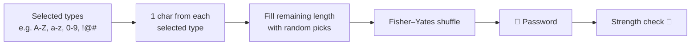

<div align="center">

# 🔑 Password Generator

**Generate strong, random passwords in one click — choose the length and character types, see a live strength indicator, and copy to clipboard.**

[](https://password-generator-shariq2003s-projects.vercel.app/)


[Features](#-features) · [How it works](#-how-it-works) · [Strength rules](#-strength-indicator) · [Getting Started](#-getting-started)

</div>

---

## ✨ Features

- 🎚️ **Length slider** — 1 to 20 characters
- ☑️ **Character options** — uppercase, lowercase, numbers, symbols
- ✅ **Guaranteed variety** — at least one character from every selected type
- 🔀 **Fisher–Yates shuffle** so the guaranteed characters aren't predictable
- 🚦 **Live strength indicator** — red, yellow or green glow
- 📋 **One-click copy** with a "copied" tooltip

## 🔄 How it works



## 🚦 Strength indicator

| Colour | Rule |
|---|---|
| 🟢 **Strong** | Upper **and** lower case, plus a number or symbol, and length ≥ 8 |
| 🟡 **Medium** | Any letters, plus a number or symbol, and length ≥ 6 |
| 🔴 **Weak** | Anything else |

## 🚀 Getting Started

No dependencies, no build step:

```bash
git clone https://github.com/Shariq2003/Password_Generator-.git
cd Password_Generator-
# open index.html in your browser
```

> ℹ️ The clipboard API needs HTTPS or `localhost` — use the live demo or `npx serve .` if copy doesn't work from a local file.

<details>
<summary><b>📁 Project structure</b></summary>

```text
Password_Generator-/
├── index.html
├── index.css
└── index.js     # generation, shuffle, strength, clipboard
```

</details>

---

<div align="center">

Built by **[Shariq](https://github.com/Shariq2003)** · [LinkedIn](https://www.linkedin.com/in/shariq-sd)

⭐ If you like this project, consider giving it a star!

</div>
